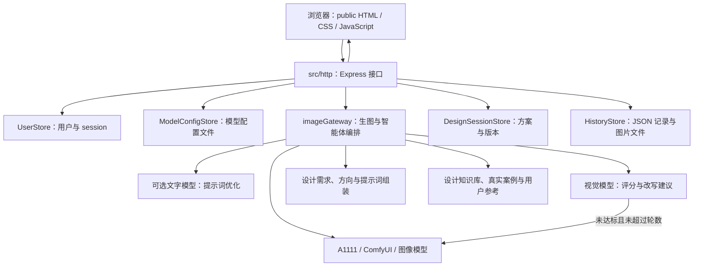

# 木生 AI · 功能与架构说明

依据 2026-09-20 当前工作区源码整理。面向接手开发、产品和模型维护人员；运行与交接流程见 [团队接管手册](TEAM_HANDOVER.md)。

## 功能清单

“已实现”表示代码中已有实现，不代表所有外部模型服务已在本次交接中联调通过。

| 功能 | 当前能力与边界 | 主要代码入口 |
| --- | --- | --- |
| 需求输入与风格设置 | 中文描述、英文 Prompt，明式 / 新中式 / 宋韵 / 禅意，精细度、氛围、画布设置 | `public/studio.html`、`public/js/studio.js` |
| 提示词处理 | 中文关键词翻译、领域增强、结构化英文尽量保留；可选文字模型优化，失败回退 | `public/js/studio.js`、`src/providers/textModel.js` |
| 普通生成 | 工作台只提供在线图像模型（兼容 OpenAI 图像接口）；后端仍保留 A1111 / ComfyUI 适配，但界面不再暴露，默认引擎为 `imageModel` | `src/imageGateway.js`、`src/providers/` |
| 设计需求 | 把描述整理成必须项、禁止项（含推出的禁止项）、风格偏好、开放项、假设与冲突；核心矛盾先请用户确认 | `src/design/brief.js`、`public/js/modules/designAgent.js` |
| 设计方向 | 锁定方向并保存；生成另一个版本 / 探索新方向 / 继续细化；无想法时给三个方向；当代宋式独立方向 | `src/design/direction.js`、`src/generationTasks.js` |
| 智能体生成 | 生图 → 四项评审（需求、风格、合理性、一致性，附证据）→ 定向修正 → 以上一版图片为输入再生成；违反需求不能靠高分抵消，评审缺字段记为不完整；默认目标 85 分、2 轮，最多 3 轮 | `src/imageGateway.js`、`src/design/evaluation.js`、`src/providers/` |
| 参考库 | 43 个真实案例（附出处，材料与尺寸标明依据，图片只给链接）；用户上传参考图与文档，按账号隔离，可改标注 | `src/references/`、`src/userReferences.js`、`src/design/references.js` |
| 模型设置 | 保存引擎地址、LoRA、checkpoint、workflow、文字 / 图像 / 视觉模型配置 | `src/modelConfigStore.js`、`server.js` |
| 结果迭代 | 预览、下载；结果面板显示锁定需求、参考用途、改动与未解决问题；版本对比与恢复；三张概念视图（不是工程图纸） | `public/js/modules/designAgent.js`、`src/designSessions.js` |
| 历史管理 | 服务端存储、读取、恢复和删除普通 / 智能体记录及图片，支持重启后读取 | `src/historyStore.js`、`public/js/studio.js` |
| 设计知识库 | 内置知识条目按风格与关键词检索，交给提示词模型、生图与评审；新中式默认，评审额外检查古旧风险（见 [KNOWLEDGE_BASE](KNOWLEDGE_BASE.md)） | `src/referenceKnowledge.js`、`src/knowledge/` |
| 账号与权限 | 注册、登录、HttpOnly session、个人资料、用户隔离；管理员由随机用户 ID allowlist 指定 | `src/userStore.js`、`src/http/middleware.js`、`src/http/routes.js` |
| 发布 | Node 直接运行、Docker 本地构建、GitHub Actions 测试与 GHCR 发布；更新由维护者明确执行 | Docker 文件、`.github/workflows/docker-image.yml` |

界面当前默认进入智能体模式。画布默认 `16:9-720p`（1280×720），另有 16:9 1080p、4:3 720p / 1080p；后端兼容旧方形尺寸。图像模型有独立请求尺寸配置，不能假设所有引擎最终输出尺寸完全一致。

“继续细化”把上一版图片作为输入，限定修改范围并列出要保留的部分，再由一致性评审检查有没有改动未要求的地方。Codex CLI 是以图片为条件重新生成，不是像素级或蒙版局部编辑；也没有实现家具 CAD 建模。各引擎的真实能力见 [设计智能体](DESIGN_AGENT.md#6-模型能力)。视觉模型评分属于模型建议，不能替代真实家具的结构、工艺或承重验证。

## 架构与数据流



普通生成：前端组成提示词和参数 → `/api/generate` → 网关归一化并调用 Provider → 保存历史 → 返回结果。

智能体生成：前端提交需求、目标分数和轮数 → `/api/agent/run` → 网关进行多轮生图与视觉评审 → 达标或到达轮数上限停止 → 返回最佳结果并持久化。当前长任务通过一次 HTTP 请求等待结果，没有独立任务队列或任务状态轮询接口。

## 代码结构和修改入口

```text
项目根目录/
├── public/                              白名单静态页面、脚本、样式与公开图片
├── server.js                            环境读取、依赖装配与监听入口
├── src/
│   ├── http/                            createApp、共享路由和安全中间件
│   ├── userStore.js                     用户、session 和原子 JSON 文件
│   ├── imageGateway.js                  多引擎调度、文字增强、智能体闭环
│   ├── modelConfigStore.js              配置读取、规范化与保存
│   ├── historyStore.js                  历史索引与图片文件
│   ├── referenceKnowledge.js            知识检索与格式化
│   ├── design/                          需求、方向、提示词组装、评审、细化、参考选择
│   ├── references/                      真实案例库
│   ├── designSessions.js                设计会话与版本
│   ├── userReferences.js                用户上传的参考资料
│   ├── knowledge/                       知识条目、风格配置
│   ├── lib/requestNormalizer.js         尺寸、风格、质量等参数归一化
│   └── providers/                       外部模型适配
├── public/assets/                       页面公共图片
├── test/                                Node 内置测试
├── docs/                                使用、发布与团队文档
├── .github/workflows/docker-image.yml    自动测试、构建与发布
└── Dockerfile / docker-compose*.yml      容器运行配置
```

新增风格时需一起检查前端选择项、提示词与后端风格映射；调整尺寸需同步前端选项、`requestNormalizer` 和测试；新增模型厂商优先扩展 Provider，再接入网关和配置面板；改评审规则查看视觉 Provider 与智能体循环。详细文件说明见 [FILE_MAP.md](FILE_MAP.md)。

## 接口清单

`/api/v1` 是规范前缀，`/api` 作为旧客户端兼容别名；两者挂载同一个 router 和同一套认证、Origin、错误处理中间件。

| 方法与路径 | 用途 |
| --- | --- |
| `GET /api/live` | 轻量进程存活检查；不调用外部模型 |
| `GET /api/health` | 网关及引擎状态；具体可用性受模型服务影响 |
| `GET /api/engines` | 支持的引擎和默认引擎 |
| `POST /api/auth/register`、`POST /api/auth/login` | 注册或登录并设置 HttpOnly session cookie |
| `POST /api/auth/logout`、`GET /api/auth/me`、`PATCH /api/auth/profile` | 注销、读取当前用户、修改个人资料 |
| `GET /api/config` / `POST /api/config` | 管理员读取脱敏配置 / 修改全实例配置 |
| `POST /api/generate` | 登录后普通或并行生成并保存当前用户历史 |
| `POST /api/agent/run` | 登录后多轮生成评审并保存当前用户历史 |
| `GET /api/reference-cases` | 设计知识条目，可用 `?style=` 过滤 |
| `POST /api/v1/generation-tasks` | 后台生成任务（新方案、另一个版本、新方向、继续细化、三视图） |
| `POST /api/v1/design/brief`、`POST /api/v1/design/directions` | 预览结构化需求与默认方向；三个候选方向 |
| `GET /api/v1/capabilities`、`GET /api/v1/real-cases` | 引擎能力声明；真实案例库 |
| `GET /api/v1/design-sessions[/:id]`、`POST /api/v1/design-sessions/:id/restore` | 当前账号的方案与版本；恢复版本 |
| `GET/POST /api/v1/references`、`PATCH/DELETE /api/v1/references/:id`、`GET /api/v1/references/:id/file` | 当前账号的参考资料 |
| `GET /api/history` | 历史列表，可传 `limit`，默认 100、最多 500 |
| `GET /api/history/:id` | 单条历史 |
| `DELETE /api/history/:id` | 删除记录及已保存图片 |
| `GET /api/history/assets/:filename` | 读取持久化图片 |

报告接口返回包含 `content`、`filename` 和 `mimeType` 的 JSON，前端将其下载为 Markdown。生成、智能体、历史列表/详情/删除、历史图片和报告要求登录；记录按 `ownerId` 隔离，迁移中的无 owner 记录只对管理员开放。Cookie 的 `Secure` 属性由 `COOKIE_SECURE` 显式控制，本地 HTTP 默认可用。Origin 留空允许无 Origin 的本地工具，浏览器跨源请求必须命中精确 allowlist。

## 接下来按什么顺序建设

1. 完成管理员 ID 初始化、Origin allowlist、Cookie Secure 策略和数据备份演练。
2. 做真实模型验收，确认模型服务地址和费用边界。
3. 多人实际使用后补任务队列、并发与费用控制、共享数据库或文件锁。
4. 根据真实需求再做 LoRA 枚举、专用 ComfyUI workflow、前端拆分与更多模型适配。

协作编辑、任务队列、数据库存储、LoRA 自动枚举和 CAD / 三维结构输出均不在当前已实现清单内。真实付费模型服务的联调也不由 CI 代替。
