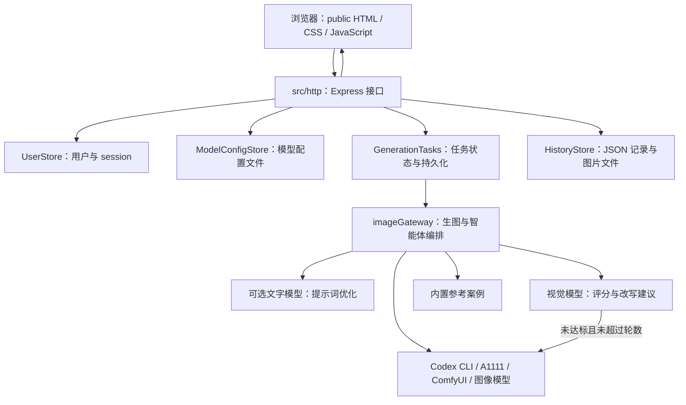

# 木生 AI · 功能与架构说明

依据 2026-11-07 `main`（v3 界面，PR #4–#12）更新。面向接手开发、产品和模型维护人员；运行与交接流程见 [团队接管手册](TEAM_HANDOVER.md)，当前进度与下一步见 [项目现状](PROJECT_STATUS.md)，Pi 工作台方案见 [PI_WORKBENCH_PLAN](PI_WORKBENCH_PLAN.md)。本页说明源码能力，不代表生产部署或真实模型联调已经验证。

## 功能清单

“已实现”表示代码中已有实现，不代表所有外部模型服务已在本次交接中联调通过。

| 功能 | 当前能力与边界 | 主要代码入口 |
| --- | --- | --- |
| 画布工作台 | 版本是画布上的卡片与连线（版本树）；单一输入栏：未选版本「生成」、选中后「修改 vN」、运行中「停止」；框选「改一处」、对比、导出、迭代评分 | `public/studio.html`、`public/js/studio.js`、`public/js/studio/` |
| 需求输入与风格设置 | 中文描述、英文 Prompt，明式 / 新中式 / 宋韵 / 禅意，精细度、氛围、画布设置 | `public/studio.html`、`public/js/studio.js` |
| 提示词处理 | 中文关键词翻译、领域增强、结构化英文尽量保留；可选文字模型优化，失败回退 | `public/js/studio.js`、`src/providers/textModel.js` |
| 普通生成 | 工作台提供 Codex 图像生成和在线图像模型；实际可用项由服务端配置决定。后端保留 A1111 / ComfyUI 适配，界面隐藏这些旧选项 | `src/imageGateway.js`、`src/providers/` |
| 智能体生成 | 生图 → 视觉评分 → 修正 Prompt → 再生成；返回各轮、最佳轮与评分；默认目标 85 分、2 轮，后端限制最多 3 轮 | `src/imageGateway.js`、`src/providers/visionModel.js` |
| 模型设置 | 保存引擎地址、LoRA、checkpoint、workflow、文字 / 图像 / 视觉模型配置 | `src/modelConfigStore.js`、`server.js` |
| 基于上一版修改 | 「修改」「改一处」「再来一版」把上一版图片交给模型（Codex 作附件，兼容图像接口走 `/images/edits`）；「改一处」另传归一化框选 `region`。不支持的引擎或缺图时报错，不退回纯文字重画；区域是指示，不是像素蒙版 | `src/generationTasks.js`、`src/imageGateway.js`、`src/providers/` |
| 历史管理 | 服务端存储、读取、恢复和删除普通 / 智能体记录及图片，支持重启后读取 | `src/historyStore.js`、`public/js/studio.js` |
| 后台任务 | 创建、轮询、刷新恢复；单次与迭代都可立即取消（终止子进程 / HTTP 请求，确认退出后才释放槽位，终态 `cancelled`）；按账号隔离、请求去重、全站最多一个活动任务 | `src/generationTasks.js`、`src/http/routes.js` |
| 额度 | 每人滚动一小时生成、评审各 20 次，按实际调用计数；任务按最多轮数预留、结束结算退回；工作台剩 5 次以内显示数字 | `src/generationQuota.js` |
| 首页 | 预渲染 ASCII 主视觉、自动播放的工作台演示、作品墙（字符版显影成实图） | `public/index.html`、`public/js/home.js`、`public/css/home*.css` |
| 语言与主题 | 简体 / 繁體 / English，顶栏「中 / 繁 / EN」切换，首访跟随浏览器；日夜两套主题 | `public/js/modules/locale*.js`、`public/js/modules/dock.js` |
| 教学案例 | 内置案例展示与匹配，作为评审的参考；不是外部实时知识库 | `src/referenceKnowledge.js` |
| 账号与权限 | 注册、登录、HttpOnly session、个人资料、用户隔离；管理员由随机用户 ID allowlist 指定 | `src/userStore.js`、`src/http/middleware.js`、`src/http/routes.js` |
| 发布 | Node 直接运行、Docker 本地构建、GitHub Actions 测试（含必跑的 Chromium 与 iPhone WebKit 浏览器流程）与 GHCR 发布；生产更新由维护者明确执行 | Docker 文件、`.github/workflows/docker-image.yml` |

界面当前默认进入智能体模式。画布默认 `16:9-720p`（1280×720），另有 16:9 1080p、4:3 720p / 1080p；后端兼容旧方形尺寸。图像模型有独立请求尺寸配置，不能假设所有引擎最终输出尺寸完全一致。

界面组件与规则见 [UI 组件规则](UI_RULES.md) 和 `/lab/components.html`。修改基于上一版图片，但不是像素级局部重绘，也不是家具 CAD 建模。视觉模型评分属于模型建议，不能替代真实家具的结构、工艺或承重验证。

## 架构与数据流



普通生成：前端组成提示词和参数 → `POST /api/v1/generation-tasks` → 返回 202 与任务 → 轮询任务状态 → 网关调用 Provider → 保存历史与结果。

智能体生成：创建 `mode: agent` 的后台任务 → 多轮生图与视觉评审 → 每轮保存结果 → 达标、达到轮数上限或收到停止请求后结束。刷新页面会重新查询活动任务。服务端重启后，原活动任务依据已存结果标为完成或失败，不自动恢复推理或重发模型请求。旧 `/generate` 和 `/agent/run` 接口仍保留兼容行为，Codex 引擎也返回异步任务。

## 代码结构和修改入口

```text
项目根目录/
├── public/                              白名单静态页面、脚本、样式与公开图片
├── server.js                            环境读取、依赖装配与监听入口
├── src/
│   ├── http/                            createApp、共享路由和安全中间件
│   ├── userStore.js                     用户、session 和原子 JSON 文件
│   ├── imageGateway.js                  多引擎调度、文字增强、智能体闭环
│   ├── generationTasks.js               后台任务、去重、状态持久化与停止
│   ├── modelConfigStore.js              配置读取、规范化与保存
│   ├── historyStore.js                  历史索引与图片文件
│   ├── referenceKnowledge.js            案例数据与匹配
│   ├── lib/requestNormalizer.js         尺寸、风格、质量等参数归一化
│   └── providers/                       外部模型适配
├── public/assets/                       页面公共图片
├── test/                                Node 内置测试
├── docs/                                使用、发布与团队文档
├── .github/workflows/docker-image.yml    自动测试、构建与发布
└── Dockerfile / docker-compose*.yml      容器运行配置
```

新增风格时需一起检查前端选择项、提示词与后端风格映射；调整尺寸需同步前端选项、`requestNormalizer` 和测试；新增模型厂商优先扩展 Provider，再接入网关和配置面板；改评审规则查看视觉 Provider 与智能体循环。详细文件说明见 [FILE_MAP.md](FILE_MAP.md)。

## 接口清单

`/api/v1` 是规范前缀，`/api` 作为旧客户端兼容别名；两者挂载同一个 router 和同一套认证、Origin、错误处理中间件。

| 方法与路径 | 用途 |
| --- | --- |
| `GET /api/live` | 轻量进程存活检查；不调用外部模型 |
| `GET /api/health` | 网关及引擎状态；具体可用性受模型服务影响 |
| `GET /api/engines` | 支持的引擎和默认引擎 |
| `POST /api/auth/register`、`POST /api/auth/login` | 注册或登录并设置 HttpOnly session cookie |
| `POST /api/auth/logout`、`GET /api/auth/me`、`PATCH /api/auth/profile` | 注销、读取当前用户、修改个人资料 |
| `GET /api/config` / `POST /api/config` | 管理员读取脱敏配置 / 修改全实例配置 |
| `POST /api/generate` | 登录后普通或并行生成并保存当前用户历史 |
| `POST /api/agent/run` | 登录后多轮生成评审并保存当前用户历史 |
| `GET /api/generation-tasks` / `POST /api/generation-tasks` | 当前账号活动任务 / 创建任务；可选 `parentId`（须属于当前用户且有图片）与 `region`（0–1 的 x、y、width、height，须带 `parentId`）；删除父记录后子记录的 `parentId` 变为 `null` |
| `GET /api/generation-tasks/quota` | 当前账号剩余生成、评审次数与最早恢复时间 |
| `GET /api/generation-tasks/:id` | 单个任务状态与结果 |
| `POST /api/generation-tasks/:id/stop` | 立即取消单次或迭代任务；已保存图片保留，已发出的请求可能仍计入额度 |
| `GET /api/reference-cases` | 内置参考案例 |
| `GET /api/history` | 历史列表，可传 `limit`，默认 100、最多 500 |
| `GET /api/history/:id` | 单条历史 |
| `DELETE /api/history/:id` | 删除记录及已保存图片 |
| `GET /api/history/assets/:filename` | 读取持久化图片 |

以上接口在 `/api/v1` 下同样可用。当前没有报告导出接口。生成、任务、额度和历史接口要求登录；记录按 `ownerId` 隔离，迁移中的无 owner 记录只对管理员开放。Cookie 的 `Secure` 属性由 `COOKIE_SECURE` 显式控制，本地 HTTP 默认可用。Origin 留空允许无 Origin 的本地工具，浏览器跨源请求必须命中精确 allowlist。

## 接下来按什么顺序建设

见 [项目现状](PROJECT_STATUS.md)。

协作编辑、跨进程可靠队列、数据库存储、LoRA 自动枚举和 CAD / 三维结构输出均不在当前已实现清单内。真实付费模型服务的联调也不由 CI 代替。
